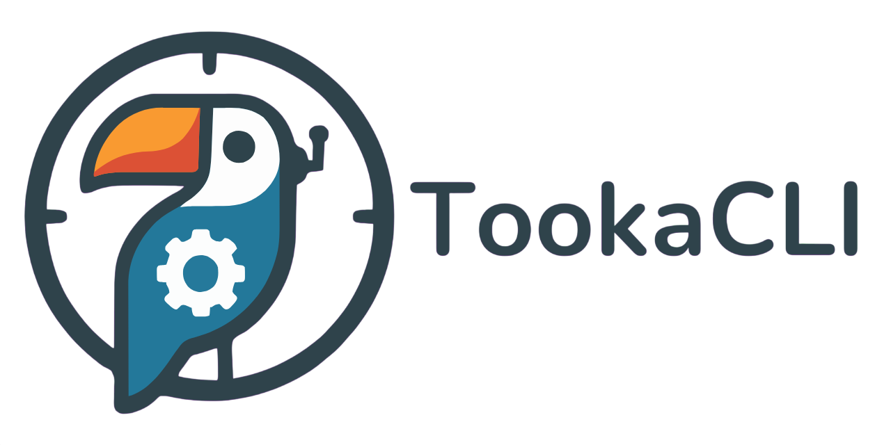

# Tooka

[![clippy]](https://github.com/Benji377/tooka/actions/workflows/clippy.yml)
[![test]](https://github.com/Benji377/tooka/actions/workflows/test.yml)
[![tooka version][crates-tooka]](https://crates.io/crates/tooka)

[clippy]: https://img.shields.io/github/actions/workflow/status/Benji377/tooka/clippy.yml?label=Clippy&logo=rust&style=for-the-badge&labelColor=555555
[test]: https://img.shields.io/github/actions/workflow/status/Benji377/tooka/test.yml?label=Tests&logo=githubactions&style=for-the-badge&labelColor=555555
[crates-tooka]: https://img.shields.io/crates/v/tooka?logo=rust&style=for-the-badge&labelColor=555555

<div align="center">
  
</div>

A fast, rule-based CLI tool for organizing files.

---

## Introduction

**Tooka** is a flexible command-line tool for automating your filesystem: organize, rename, move, copy, or delete files using simple, powerful YAML rules.

You define what files to match (by name, extension, metadata, size, etc.) and what should happen to them — Tooka handles the rest with blazing-fast parallel processing. With built-in background monitoring, Tooka can continuously keep your folders organized automatically.

---

## Features

* **Rule-based automation** - Define custom file organization rules using declarative YAML
* **Automatic monitoring** - Set up background monitoring to automatically sort folders at intervals
* **High-performance** - Files are matched against your rules in parallel
* **Flexible filtering** - Match files by name patterns, extensions, MIME types, size, metadata, and timestamps
* **Multiple actions** - Move, copy, rename, delete, run a command, or skip files based on conditions
* **Template support** - Dynamic file naming with customizable templates
* **Safe operations** - A sort either completes or is undone; existing files are never overwritten, and `tooka recover` cleans up after a crash
* **Cross-platform** - Works seamlessly on Windows, macOS, and Linux

---

## Installation

Packages for Windows (also via `winget install Benji377.Tooka`), macOS and
Linux are on the [releases page](https://github.com/Benji377/tooka/releases).
With Rust installed:

```bash
cargo install tooka
```

More options in [docs/installation.md](docs/installation.md).

---

## Quick Start

```bash
# Start from a commented example rule, then add it
tooka template --output my-rule.yaml
tooka validate my-rule.yaml
tooka add my-rule.yaml

# Preview, then sort (the default source folder, or --source)
tooka sort --dry-run
tooka sort --source ~/Downloads

# Monitor folder automatically
tooka monitor add ~/Downloads --interval 300
tooka monitor daemon run
```

See the **[documentation](docs/README.md)** for installation, the complete
[rule reference](docs/rules.md), [monitoring](docs/monitoring.md) and more.

---

## Performance

Tooka is designed for speed with:
- Parallel file processing using Rayon
- Optimized hot paths with cached operations
- Comprehensive benchmark suite to track performance

Run performance benchmarks:
```bash
cargo bench
```

See [benches/README.md](benches/README.md) for details.

---

## Contributing

We welcome contributions! Please see:

- [Contributing Guidelines](CONTRIBUTING.md) 
- [Code of Conduct](CODE_OF_CONDUCT.md)

---

## Community & Support

- **Bug Reports**: [GitHub Issues](https://github.com/Benji377/tooka/issues)
- **Feature Requests**: [GitHub Issues](https://github.com/Benji377/tooka/issues)
- **Documentation**: [docs folder](docs/README.md)

---

## License

Licensed under [GPLv3](LICENSE)

---

<div align="center">
  <sub>Built with ❤️ in Italy 🇮🇹</sub>
</div>
